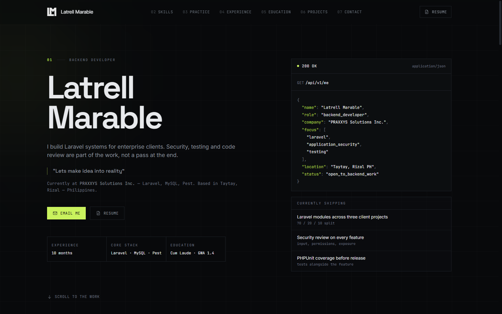

<div align="center">

# LatsMarbls

**Laravel Backend Developer**

Personal portfolio — from a prompt-style loading screen to a cursor swarm that draws the page in front of you.

[](https://github.com/LatsMarbls/latsmarbls/releases/tag/v2.1.5)
[](https://latsmarbls.vercel.app)
[](https://react.dev)
[](https://vitejs.dev)
[](https://tailwindcss.com)

</div>

## Live demo

- **v2 — Cursor swarm redesign:** [latsmarbls.vercel.app](https://latsmarbls.vercel.app)
- **v1 — Legacy portfolio:** [v1.0.0 archive](https://github.com/LatsMarbls/latsmarbls/tree/v1.0.0)

## What’s special

This version of the site is built around an **AI-agent loading experience**:

1. A terminal-style intro types out a build command.
2. A swarm of cursors scans the page and draws every section.
3. The overlay fades to reveal the finished portfolio.

The whole thing is interactive — you can skip the build at any time, and reduced-motion users get a fast, accessible fallback.

## Preview



## Features

- Prompt-style intro loading screen
- Cursor swarm rebuild / tour overlay
- Randomized design variants for every section, cached per visitor
- Responsive dark UI
- Single `<h1>`, focus outlines, screen-reader friendly markup
- Reduced-motion safe
- Vercel Analytics

## Tech stack

- **React 18** + **Vite 6**
- **Tailwind CSS 3**
- **Framer Motion** for the intro transition
- Custom `public/swarm.js` for the cursor swarm

## Project structure

```text
public/
  swarm.js           # vendored cursor-swarm rebuild script
  LM.svg             # white monogram logo
src/
  content/           # site copy, skills, projects, version
  sections/          # Hero, Skills, Practice, Experience, Projects, Contact, Footer
  ui/                # Intro, SwarmRebuild, Icons, Reveal, Section
```

## Randomized designs

Each visit picks a random prepared design for the navbar, hero, every section and the footer. The selection is cached in `localStorage` under `lm-design-v2.1.0`, so repeat visits show the same layout until the cache is cleared.

Force a new selection by adding `?design=shuffle` to the URL:

```text
https://latsmarbls.vercel.app/?design=shuffle
```

For testing a specific combination, use section overrides:

```text
https://latsmarbls.vercel.app/?design=nav:1,hero:2,skills:0,practice:1,experience:2,projects:0,contact:1,footer:2
```

## Getting started

```bash
npm install
npm run dev
```

Other scripts:

```bash
npm run build      # production build
npm run preview    # preview the production build
npm run lint       # run ESLint
```

## Versioning

| Version | Status | Release | Source |
|---|---|---|---|
| v2.1.5 | Current / live | [v2.1.5](https://github.com/LatsMarbls/latsmarbls/releases/tag/v2.1.5) | `main` |
| v2.1.4 | Previous | [v2.1.4](https://github.com/LatsMarbls/latsmarbls/releases/tag/v2.1.4) | `main` history |
| v2.1.3 | Previous | [v2.1.3](https://github.com/LatsMarbls/latsmarbls/releases/tag/v2.1.3) | `main` history |
| v2.1.2 | Previous | [v2.1.2](https://github.com/LatsMarbls/latsmarbls/releases/tag/v2.1.2) | `main` history |
| v2.1.1 | Previous | [v2.1.1](https://github.com/LatsMarbls/latsmarbls/releases/tag/v2.1.1) | `main` history |
| v2.1.0 | Previous | [v2.1.0](https://github.com/LatsMarbls/latsmarbls/releases/tag/v2.1.0) | `main` history |
| v2.0.0 | Previous | [v2.0.0](https://github.com/LatsMarbls/latsmarbls/releases/tag/v2.0.0) | `main` history |
| v1.0.0 | Legacy | [v1.0.0](https://github.com/LatsMarbls/latsmarbls/releases/tag/v1.0.0) | [`v1`](https://github.com/LatsMarbls/latsmarbls/tree/v1.0.0) |

See [CHANGELOG.md](./CHANGELOG.md) for the full history.

## Deployment

The site deploys automatically to **Vercel** from the `main` branch. Pull requests and other branches get preview deployments.

## Author

**Latrell Marable**

- GitHub: [@LatsMarbls](https://github.com/LatsMarbls)
- LinkedIn: [latrell-marable](https://www.linkedin.com/in/latrell-marable-b43a37256/)
- Email: [latrellmarable00@gmail.com](mailto:latrellmarable00@gmail.com)
